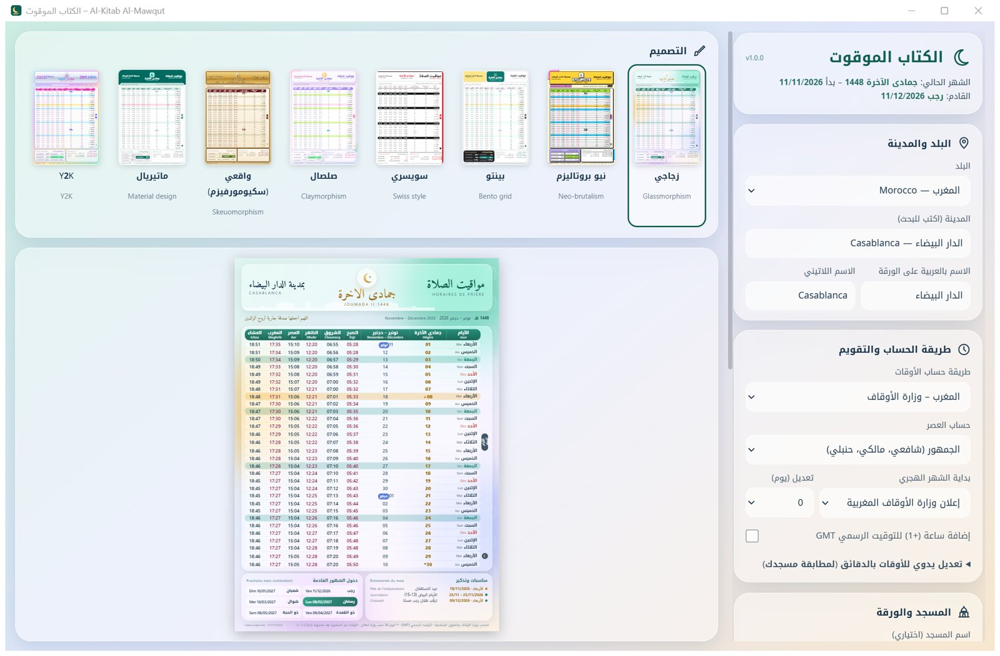
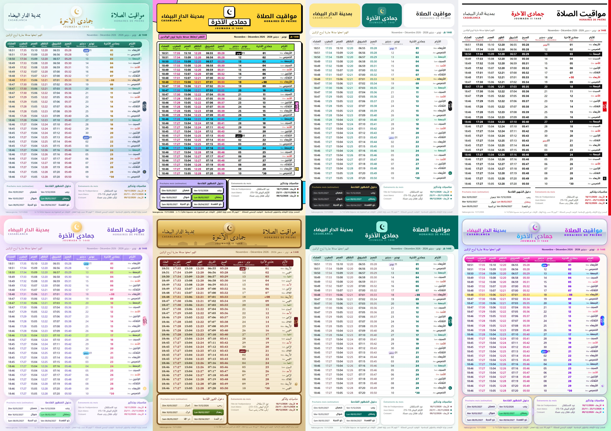

<div dir="rtl">

# كتابا موقوتا – Al-Kitab Al-Mawqut

﴿إِنَّ الصَّلَاةَ كَانَتْ عَلَى الْمُؤْمِنِينَ كِتَابًا مَّوْقُوتًا﴾

برنامج مجاني ومفتوح المصدر لأنظمة Windows وmacOS وLinux وAndroid، يصمّم **ورقة مواقيت الصلاة لشهر هجري كامل** جاهزة للتعليق في المسجد أو البيت، ويطبعها **تلقائياً عند دخول كل شهر هجري**.





## المزايا
- 8 تصاميم: زجاجي (Glassmorphism)، Neo-brutalism، Bento، سويسري، صلصال (Claymorphism)، واقعي (Skeuomorphism)، Material، Y2K.
- **كل دول العالم**: اختر البلد والمدينة، و22 طريقة حساب معتمدة (رابطة العالم الإسلامي، أم القرى، الهيئة المصرية، ديانت، ISNA، فرنسا، الخليج، ماليزيا، إندونيسيا…)، والعصر الحنفي أو الجمهور.
- **المغرب**: الأوقات الرسمية لوزارة الأوقاف والشؤون الإسلامية (190 مدينة)، وبداية الشهر حسب إعلان الوزارة.
- بداية الشهر الهجري: إعلان الوزارة (المغرب)، أو تقويم أم القرى، أو حساب رؤية الهلال محلياً، مع تعديل ±يوم.
- اسم المسجد وصورته أو شعاره على الورقة، ونص أو دعاء اختياري.
- لغة ثانية على الورقة: الفرنسية أو الإنجليزية.
- المناسبات الدينية، الأيام البيض، ليلة ترقّب الهلال، الأعياد الوطنية (المغرب، الجزائر، تونس، مصر، السعودية، الإمارات، فرنسا)، وتواريخ دخول الشهور القادمة.
- طباعة A4 أو A3، وملف PDF، وطباعة تلقائية اختيارية تعمل في الخلفية دون أي نافذة.
- تعديل يدوي للأوقات بالدقائق لمطابقة توقيت مسجدك.

## التثبيت
حمّل الملف المناسب لجهازك من صفحة **[Releases](../../releases/latest)**:

| النظام | الملف | الطريقة |
|---|---|---|
| Windows 10/11 | `AlKitabAlMawqut-Setup-x.y.z.exe` | شغّله واتبع الخطوات (لا يحتاج صلاحيات المدير). إن ظهر تنبيه SmartScreen: «More info» ثم «Run anyway». |
| macOS (Apple Silicon M1–M4) | `AlKitabAlMawqut-x.y.z-macOS-arm64.dmg` | افتحه واسحب البرنامج إلى Applications. أول مرة: انقر بزر الفأرة الأيمن على البرنامج ← «Open»، أو من System Settings ← Privacy & Security ← «Open Anyway» (البرنامج غير موثّق لدى Apple). |
| Linux (x86-64) | `AlKitabAlMawqut-x.y.z-linux-x86_64.tar.gz` | فكّ الضغط ثم شغّل `./AlKitabAlMawqut/install.sh` ليظهر في قائمة البرامج. |
| Android 7+ | `AlKitabAlMawqut-x.y.z-android.apk` | حمّله في الهاتف وافتحه، واسمح بـ«تثبيت تطبيقات من مصادر غير معروفة» عند الطلب. الطباعة وحفظ PDF من نافذة الطباعة في أندرويد، وتذكير بإشعار عند دخول كل شهر هجري. |

- لتصميم ورقة PDF والطباعة على macOS وLinux يستعمل البرنامج متصفح Chrome أو Chromium أو Edge أو Firefox المثبّت في الجهاز.
- **ورقة حزب القراءة** (عادة مغربية): اختر الحزب الذي يُقرأ بعد الصبح والذي يُقرأ بعد العشاء (من 1 إلى 60)، فتُطبع ورقة بنفس التصميم فيها تاريخ اليوم (هجري وميلادي) ووقتا الصلاتين والكلمات الأولى من كل حزب. زر «اليوم التالي» يتابع الختمة تلقائياً. ويمكن طباعة **ختمة الشهر كاملة** دفعة واحدة: 30 صفحة (حزبان في اليوم) على 15 ورقة A4 بالوجهين (recto-verso). الرواية قابلة للاختيار: **ورش عن نافع** بتقسيم أحزاب المصحف المغربي (النص من مجمع الملك فهد)، أو **حفص عن عاصم** (النص من مشروع تنزيل tanzil.net).
- الطباعة التلقائية (اختيارية): عند تفعيلها يقلع البرنامج مع Windows ويعمل مخفياً في الخلفية (يظهر في «تطبيقات بدء التشغيل» في الإعدادات)، وينتظر دخول الشهر الهجري ليطبع الورقة. على macOS عبر launchd، وعلى Linux عبر systemd أو cron.

</div>

---

## Français
Logiciel libre et gratuit pour Windows, macOS et Linux : il compose la **feuille mensuelle des horaires de prière** (mois de l'Hégire), en 8 styles graphiques, pour n'importe quel pays (22 méthodes de calcul), avec le nom et la photo de la mosquée, et l'imprime **automatiquement au début de chaque mois hégirien** (optionnel, en arrière-plan). Pour le Maroc, horaires officiels du Ministère des Habous.
Téléchargement : page **Releases**.

## English
Free, open-source desktop app (Windows, macOS, Linux) that designs a **monthly (Hijri) prayer-time sheet** in 8 visual styles for any country (22 calculation methods, Hanafi/Shafi'i Asr, Umm al-Qura or local moon-sighting calendar), with your mosque's name and logo, and can print it **automatically when each Hijri month begins**. Morocco uses the official Ministry of Habous timetables.
Download the installer from **Releases**.

## Android
The Android app (`android-app/`, Capacitor) is a JavaScript port of the same engine: identical times (verified 432/432 against the Python engine), same 8 designs exported from `mawaqit/themes.py` by `tools/export_web.py`. Google Play publishing guide: [docs/google-play.md](docs/google-play.md). Privacy policy: [docs/privacy-policy.md](docs/privacy-policy.md).

## Development
```
py -3.11 -m venv .venv
.venv\Scripts\pip install -r requirements.txt pyinstaller
.venv\Scripts\python run.py          # window
.venv\Scripts\python run.py --auto   # background check (used by Task Scheduler)
build.cmd                              # Windows exe + installer (needs Inno Setup 6)
./build_mac.sh                         # macOS .app + .dmg
./build_linux.sh                       # Linux tar.gz (Qt WebEngine)
```

## Credits & licenses
- Code: MIT.
- Fonts: Amiri, Noto Kufi/Sans Arabic – SIL Open Font License 1.1.
- Places: [GeoNames](https://www.geonames.org/) – CC BY 4.0.
- Morocco timetables: fetched at run time from habous.gov.ma (Ministry of Habous and Islamic Affairs).
- Hijri Umm al-Qura: [hijridate](https://github.com/dralshehri/hijridate) (MIT). Astronomy: [PyEphem](https://rhodesmill.org/pyephem/) (MIT).
