<div dir="rtl">

# دليل «كتابا موقوتا» خطوة بخطوة

﴿إِنَّ الصَّلَاةَ كَانَتْ عَلَى الْمُؤْمِنِينَ كِتَابًا مَّوْقُوتًا﴾

«كتابا موقوتا» برنامج مجاني ومفتوح المصدر (رخصة MIT)، له ثلاثة أوجه:

| الوجه | الجهاز | ماذا يفعل |
|---|---|---|
| **شاشة المسجد** | تلفاز Android TV أو جهاز TV Box | مواقيت الصلاة والإقامة، والعدّ التنازلي، وشاشة «الصلاة قائمة»، والأذكار بعد الصلاة، وحديث الجمعة، والحزب الراتب، والإعلانات، وإعلانات صيام التطوع |
| **تطبيق الهاتف** | هاتف أندرويد | ورقة مواقيت الشهر الهجري بثمانية تصاميم، والطباعة أو الحفظ PDF، وتذكير عند دخول كل شهر |
| **برنامج الحاسوب** | Windows وmacOS وLinux | تصميم الورقة وطباعتها تلقائياً عند دخول كل شهر هجري، وورقة الحزب، وختمة الشهر |

شاشة المسجد وتطبيق الهاتف ملف واحد (APK). عند أول تشغيل تختار بينهما.

---

## الفهرس
1. [تثبيت شاشة المسجد على التلفاز (Downloader)](#1-تثبيت-شاشة-المسجد-على-التلفاز)
2. [تثبيت تطبيق الهاتف وبرنامج الحاسوب](#2-تثبيت-تطبيق-الهاتف-وبرنامج-الحاسوب)
3. [أول تشغيل](#3-أول-تشغيل)
4. [شاشة المسجد: الأجزاء والمراحل](#4-شاشة-المسجد-الأجزاء-والمراحل)
5. [التصاميم](#5-التصاميم)
6. [الإعدادات بالريموت](#6-الإعدادات-بالريموت)
7. [المساجد التي لا يصلها الإنترنت](#7-المساجد-التي-لا-يصلها-الإنترنت)
8. [التحديث التلقائي](#8-التحديث-التلقائي)
9. [تطبيق الهاتف](#9-تطبيق-الهاتف)
10. [أسئلة شائعة](#10-أسئلة-شائعة)
11. [الملاحظات والاقتراحات](#11-الملاحظات-والاقتراحات)

---

## 1. تثبيت شاشة المسجد على التلفاز

**المطلوب:** تلفاز Android TV أو جهاز TV Box (أندرويد 7 فما فوق)، وريموت، واتصال بالإنترنت أثناء التنزيل.

1. في التلفاز افتح **Google Play** وابحث عن تطبيق **Downloader** (من AFTVnews، أيقونته برتقالية)، ثم ثبّته.
2. افتح **Downloader** واقبل طلب الوصول إلى الملفات إن ظهر.
3. اسمح لـ Downloader بتثبيت التطبيقات:
   الإعدادات ← التطبيقات ← الوصول الخاص للتطبيقات ← **تثبيت التطبيقات غير المعروفة** (Install unknown apps) ← Downloader ← **مسموح**.
   (قد يختلف اسم القائمة قليلاً حسب نوع الجهاز. وغالباً يأخذك Downloader إليها وحده عند أول تثبيت.)
4. في خانة العنوان داخل Downloader اكتب:

   ```
   is.gd/kitabmawqut_tv
   ```
   ثم اضغط **Go**. يُنزَّل دائماً **آخر نسخة** منشورة.
5. عند انتهاء التنزيل تظهر شاشة التثبيت: اختر **تثبيت** (Install)، ثم **فتح** (Open).
6. بعد التثبيت يمكنك حذف ملف APK من Downloader (Delete) لتوفير مساحة.
7. يظهر التطبيق في قائمة تطبيقات التلفاز باسم **«كتابا موقوتا»** مع لافتته. يمكنك إضافته إلى المفضّلة في الصفحة الرئيسية.

> ابتداءً من النسخة 1.9.5 **يحدّث التطبيق نفسه** (انظر [التحديث التلقائي](#8-التحديث-التلقائي))، فلا تحتاج إلى Downloader بعد ذلك.
> من ثبّت نسخة تجريبية قبل 1.9.5 يحذفها مرة واحدة ثم يثبّت النسخة الجديدة، لأن التطبيق صار موقّعاً بالمفتاح الرسمي للمشروع.

**رابط مباشر** (للحاسوب أو الهاتف): <https://github.com/dzizozi/kitab-mawqut/releases/latest/download/AlKitabAlMawqut-android.apk>

---

## 2. تثبيت تطبيق الهاتف وبرنامج الحاسوب

حمّل الملف المناسب لجهازك من صفحة **[Releases](https://github.com/dzizozi/kitab-mawqut/releases/latest)**:

| النظام | الملف | الطريقة |
|---|---|---|
| Android (هاتف أو تلفاز) | `AlKitabAlMawqut-x.y.z-android.apk` | افتحه في الجهاز، واسمح بـ«تثبيت تطبيقات من مصادر غير معروفة» عند الطلب |
| Windows 10/11 | `AlKitabAlMawqut-Setup-x.y.z.exe` | شغّله واتبع الخطوات. إن ظهر تنبيه SmartScreen: «More info» ثم «Run anyway» |
| macOS (M1–M4) | `AlKitabAlMawqut-x.y.z-macOS-arm64.dmg` | اسحب البرنامج إلى Applications. أول مرة: زر الفأرة الأيمن ← Open |
| Linux | `AlKitabAlMawqut-x.y.z-linux-x86_64.tar.gz` | فكّ الضغط ثم `./AlKitabAlMawqut/install.sh` |

---

## 3. أول تشغيل

### اختيار الوضع
عند أول تشغيل تختار: **في الهاتف** أو **في المسجد (تلفاز / TV Box)**. على التلفاز يكون الزر الثاني محدّداً، فيكفي الضغط على OK.

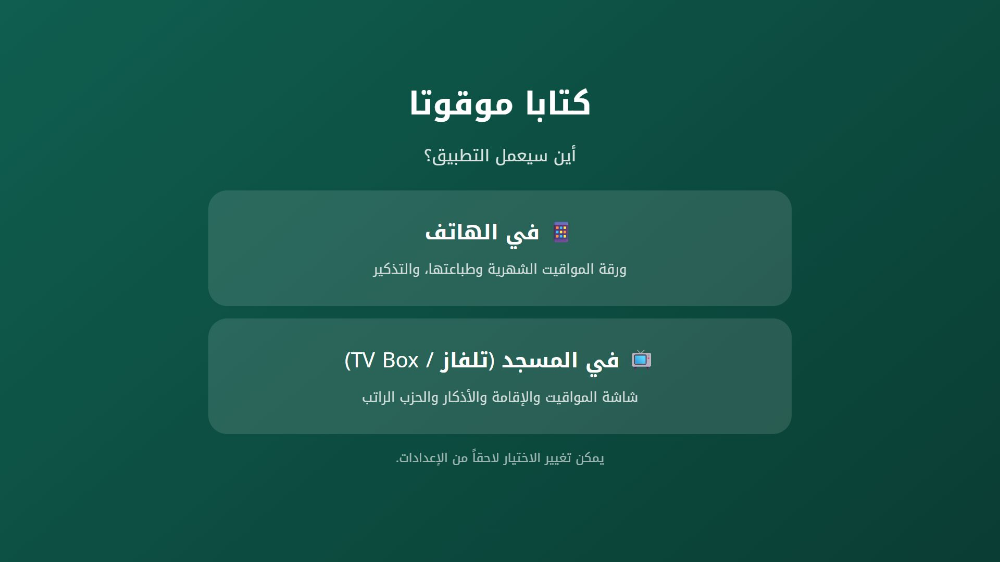

> للرجوع إلى هذه الشاشة لاحقاً: اضغط **مطوّلاً على زر الرجوع** في الريموت (ثانية تقريباً).

### الاتصال بالإنترنت
إن لم يكن الجهاز متصلاً عند أول تشغيل، يطلب التطبيق وصله بشبكة Wi-Fi أو بـ«نقطة اتصال» الهاتف (Hotspot) ولو لدقائق. يحتاج الإنترنت لجلب المواقيت الرسمية، وضبط الساعة، والبحث عن نسخة جديدة. والرسالة تختفي وحدها عند الاتصال.

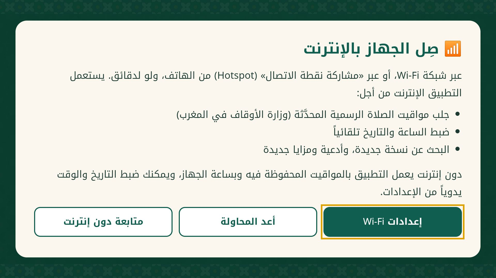

أزرار الرسالة:
- **إعدادات Wi-Fi**: تفتح شاشة الشبكات في الجهاز.
- **أعد المحاولة**: تفحص الاتصال من جديد.
- **متابعة دون إنترنت**: يعمل التطبيق بالمواقيت المحفوظة فيه. انظر [المساجد التي لا يصلها الإنترنت](#7-المساجد-التي-لا-يصلها-الإنترنت).

---

## 4. شاشة المسجد: الأجزاء والمراحل

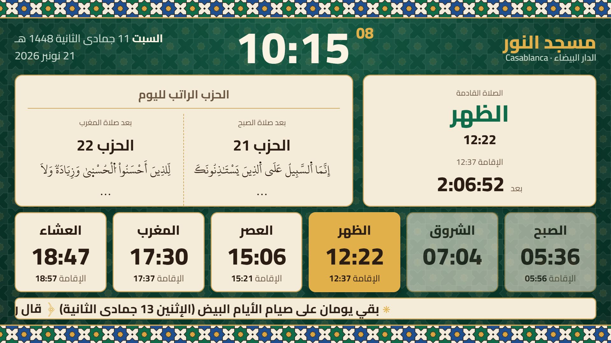

| الجزء | المكان | المحتوى |
|---|---|---|
| اسم المسجد | أعلى اليمين | الاسم والمدينة |
| الساعة | الوسط | الساعة والثواني |
| التاريخ | أعلى اليسار | اليوم، والتاريخ الهجري (حسب إعلان وزارة الأوقاف في المغرب)، والميلادي |
| الصلاة القادمة والعدّاد | يمين | اسم الصلاة، ووقت الأذان، ووقت الإقامة، والوقت المتبقي |
| اللوحة المتغيرة | يسار | تتناوب كل 15 ثانية: الحزب الراتب لليوم (بعد الصبح وبعد المغرب)، ومناسبة اليوم، وإعلانات صيام التطوع، وإعلانات المسجد |
| بطاقات المواقيت | أسفل | الصلوات الست مع وقت الإقامة. البطاقة الذهبية هي الصلاة القادمة، والباهتة صلوات مضت. بعد العشاء تظهر مواقيت الغد |
| الشريط المتحرك | أسفل الشاشة | كل الإعلانات وإعلانات الصيام، دون توقف |

### مراحل الصلاة (تتغير الشاشة وحدها)

| المرحلة | متى | الصورة |
|---|---|---|
| **الإقامة بعد…** | من الأذان إلى الإقامة: عدّ تنازلي كبير | 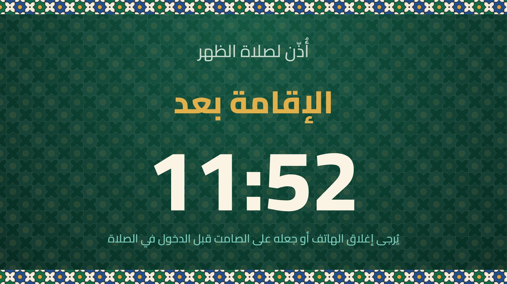 |
| **الصلاة قائمة** | مدة الصلاة: شاشة سوداء هادئة | 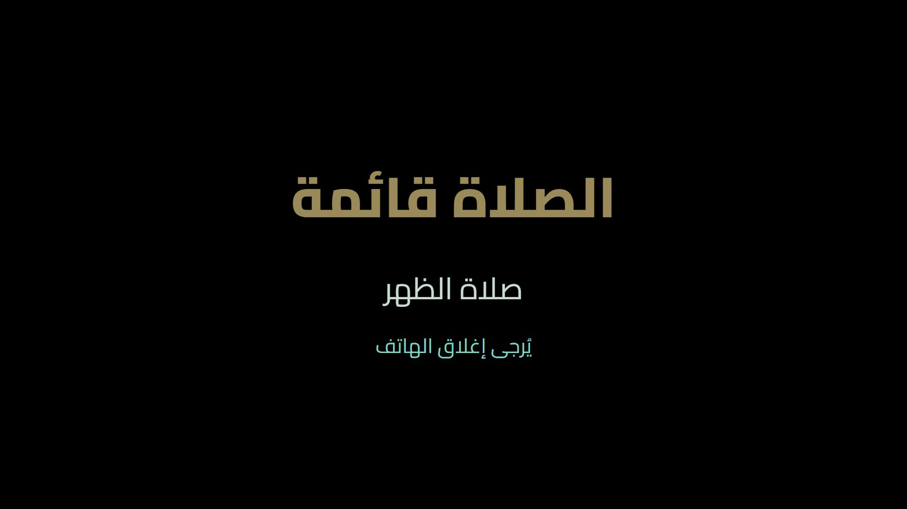 |
| **الأذكار بعد الصلاة** | بعد الصلاة، لمدة تختارها، وتتغير كل 25 ثانية | 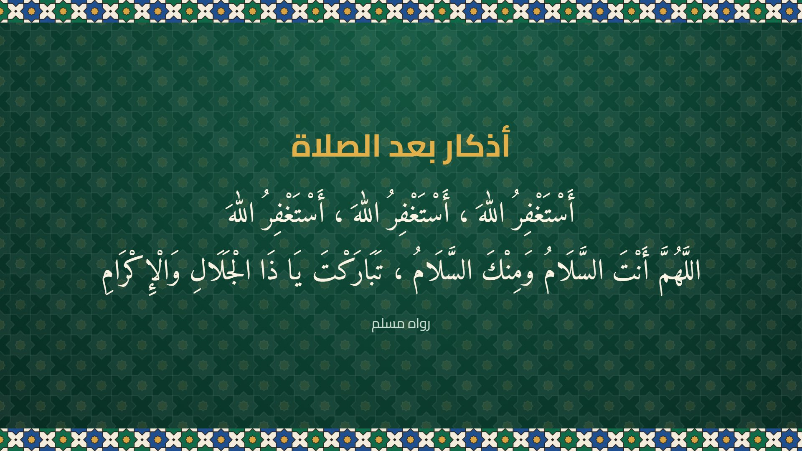 |
| **صلاة الجمعة** | قبل أذان الجمعة بالمدة التي تختارها: حديث «من لغا فلا جمعة له» والعدّ التنازلي | 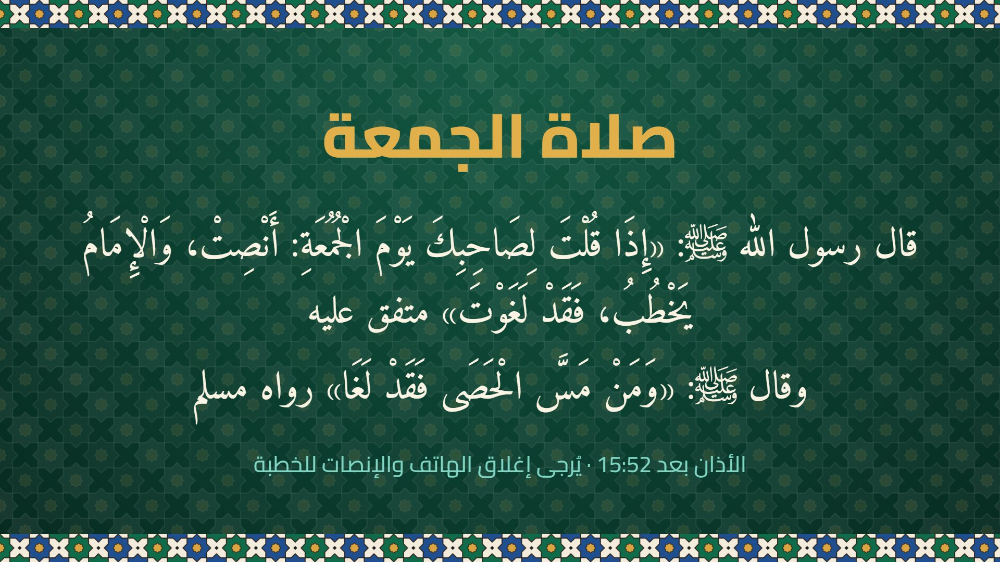 |

### إعلانات صيام التطوع (تلقائية)
تُحسب من التاريخ الهجري، وتظهر **قبل الموعد بيومين، ثم قبله بيوم، ثم في يومه**، في اللوحة وفي الشريط المتحرك طوال اليوم، مع حديث في فضل الصيام:

> ۞ بقي يوم واحد على صيام الأيام البيض (الإثنين 13 جمادى الثانية) ﴿ قال رسول الله ﷺ: «صيامُ ثلاثةِ أيامٍ من كلِّ شهرٍ صيامُ الدهرِ كلِّه» — متفق عليه ﴾ ۞

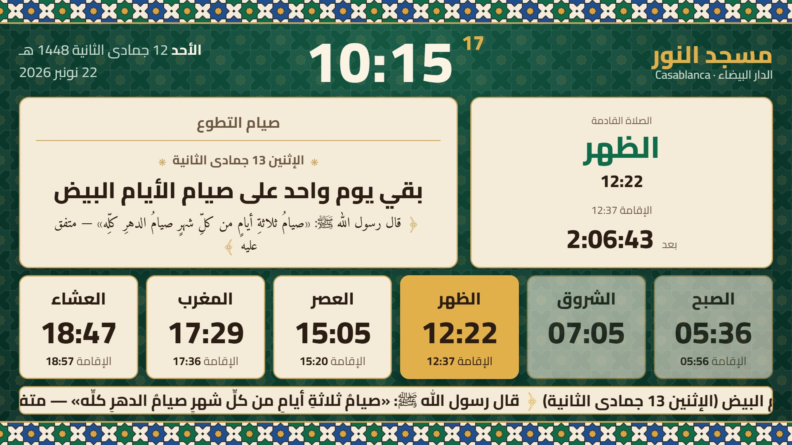

| المناسبة | الأيام |
|---|---|
| الأيام البيض | 13 و14 و15 من كل شهر هجري («أول/ثاني/ثالث الأيام البيض»)، إلا رمضان. وفي ذي الحجة لا يُذكر يوم 13 لأنه من أيام التشريق |
| تاسوعاء وعاشوراء | 9 و10 محرّم |
| شهر الله المحرّم | 1 محرّم |
| العشر من ذي الحجة ويوم عرفة | 1 إلى 9 ذي الحجة |
| الست من شوال | ابتداءً من 2 شوال |
| الإثنين والخميس | اختياري، غير مفعّل افتراضياً |

---

## 5. التصاميم

| زليج مغربي (فاس) | ليلي ذهبي |
|---|---|
|  | 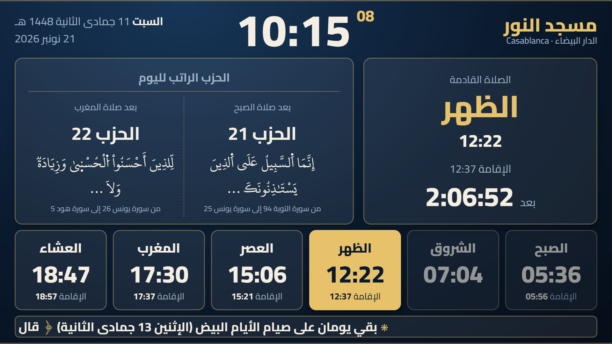 |
| **أزرق شفشاون** | **زمردي** |
| 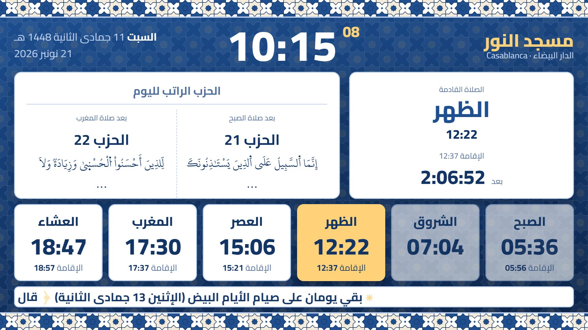 | 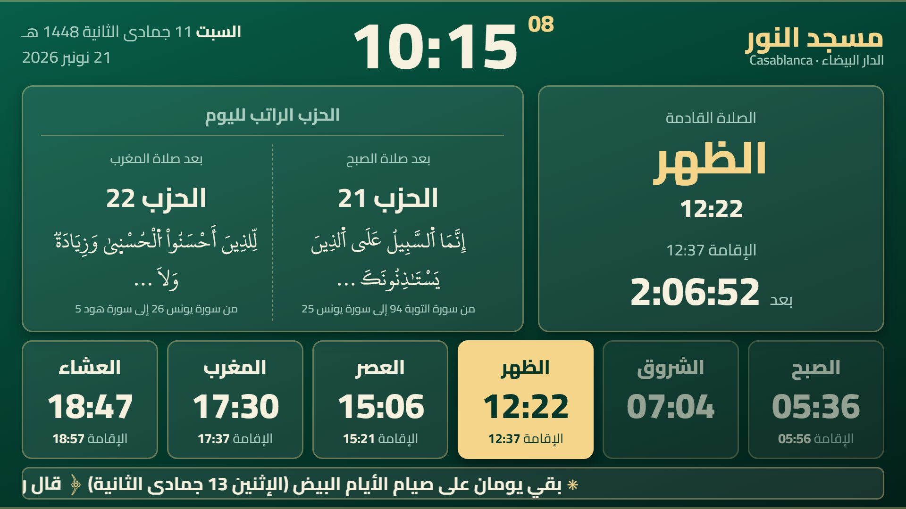 |
| **فاتح** | |
| 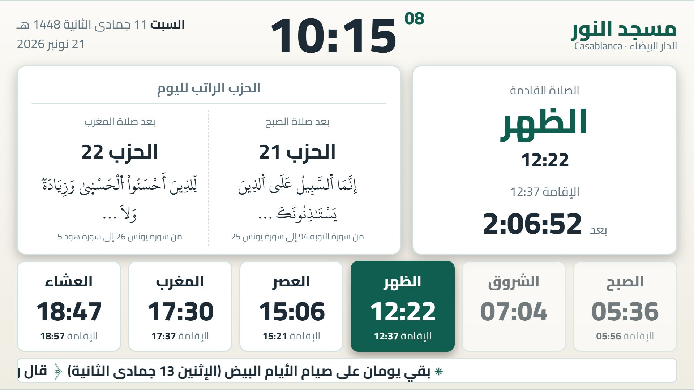 | |

كل الرسوم (الزليج والأشرطة) مرسومة بالشيفرة لا بالصور، فتبقى حادّة على شاشات 4K.

---

## 6. الإعدادات بالريموت

**فتح الإعدادات:** اضغط **OK** (الزر الأوسط) في الشاشة الرئيسية.

### أزرار الريموت

| الزر | العمل |
|---|---|
| ▲ ▼ | الصف السابق أو التالي (الخانة التي فوق أو تحت) |
| ◀ ▶ | الخانة المجاورة في الصف نفسه |
| OK | الكتابة في خانة (تظهر لوحة المفاتيح)، أو فتح قائمة، أو الضغط على زر |
| الرجوع | إغلاق لوحة المفاتيح، ثم إغلاق الإعدادات |
| الرجوع مطوّلاً | العودة إلى اختيار الوضع (هاتف / مسجد) |

- **كل خانة تُحفظ تلقائياً** عند الخروج منها، ولا يوجد زر «حفظ».
- **أثناء الكتابة** تتحرك الأسهم داخل لوحة المفاتيح. بعد الكتابة اضغط **الرجوع** لإغلاق اللوحة، ثم ▼ للنزول إلى الاقتراحات.

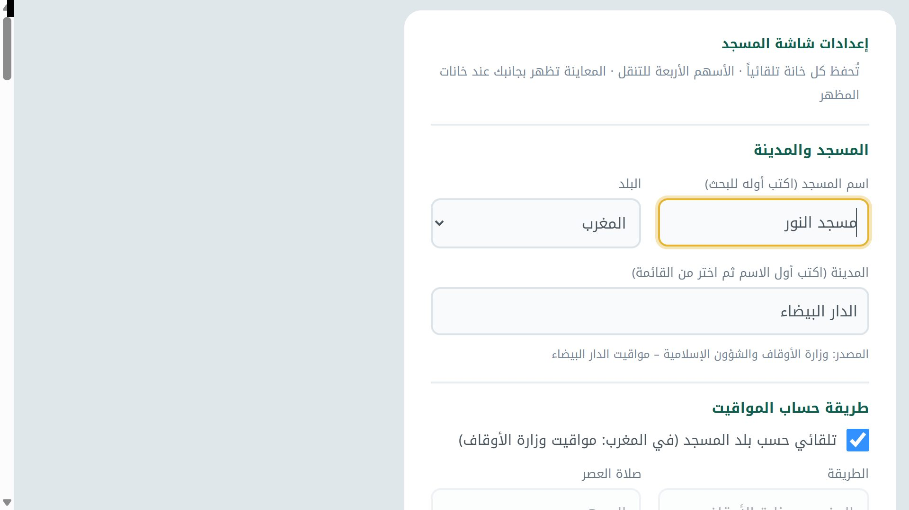

### 6.1 المسجد والمدينة
- **اسم المسجد**: اضغط OK واكتب أول الاسم، فتظهر قائمة مساجد المغرب (1797 مسجداً من OpenStreetMap) مع الحي والمدينة. اختر مسجدك بـ ▼ ثم OK. وإن لم تجده فاكتب اسمه كاملاً.
- **البلد** ثم **المدينة**: اكتب أول حرفين أو ثلاثة بالعربية أو بالفرنسية، ثم اختر من القائمة. كل مدن المغرب موجودة، والمدن غير الموجودة في قائمة الوزارة تأخذ مواقيت أقرب مدينة فيها.
- تحت المدينة سطر يبيّن مصدر المواقيت، مثل: «وزارة الأوقاف – مواقيت الدار البيضاء».

> **انتبه:** «بوسكور» مدينة في الجهة الشرقية، وهي غير «بوسكورة» قرب الدار البيضاء. اختر الاسم الصحيح.

### 6.2 طريقة حساب المواقيت
- **تلقائي حسب بلد المسجد** (مفعّل افتراضياً): في المغرب تُعتمد مواقيت **وزارة الأوقاف والشؤون الإسلامية**، وفي البلدان الأخرى الطريقة المعتمدة فيها.
- ألغِ «تلقائي» لاختيار طريقة أخرى من 22 طريقة، أو العصر الحنفي.
- **تعديل يدوي للأذان بالدقائق** لكل صلاة (مثل 2 أو -3) لمطابقة مسجدكم.

### 6.3 الإقامة ومراحل الشاشة
- الدقائق بين الأذان والإقامة لكل صلاة، وللجمعة.
- **مدة الصلاة**: مدة شاشة «الصلاة قائمة».
- **مدة الأذكار بعدها**.
- **الحديث قبل أذان الجمعة بـ** عدد من الدقائق.

عند الوقوف على هذه الخانات تظهر **معاينة حيّة** للمرحلة بجانب الإعدادات:

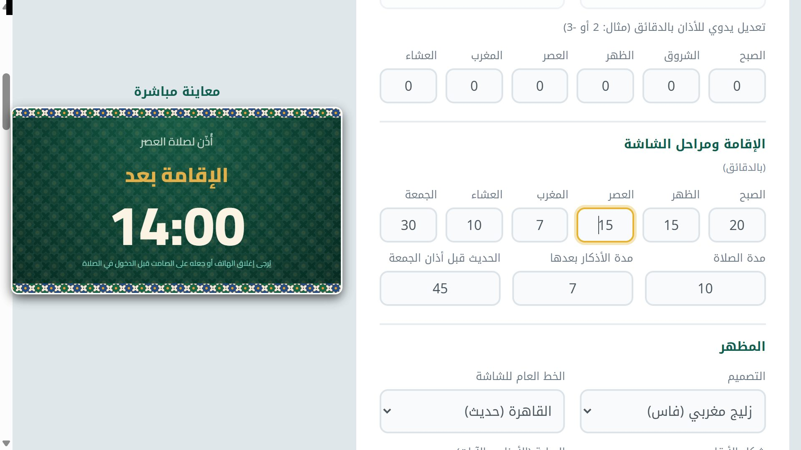

### 6.4 المظهر والمعاينة الحيّة
التصميم، والخط العام، وشكل الأرقام (0123 أو ٠١٢٣)، والرواية (ورش أو حفص). كل تغيير يظهر فوراً في الشاشة الصغيرة على اليسار، فلا تحتاج إلى الخروج من الإعدادات.

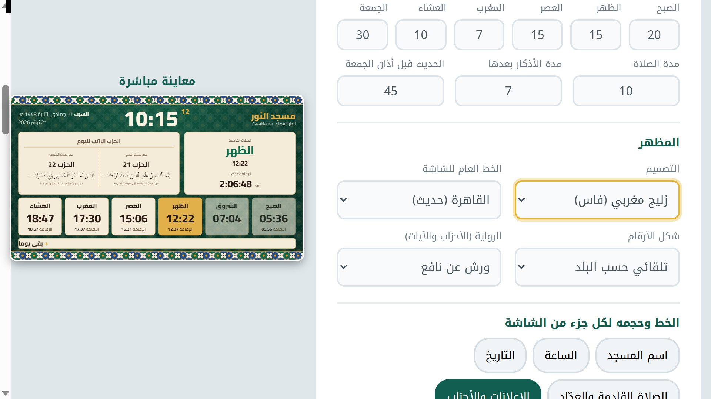

### 6.5 الخط وحجمه وتباعد الأسطر لكل جزء
1. اختر **الجزء**: اسم المسجد، الساعة، التاريخ، الصلاة القادمة والعدّاد، الإعلانات والأحزاب، بطاقات المواقيت، الشريط المتحرك، شاشة الإقامة والصلاة، الأذكار، حديث الجمعة.
2. اختر **نوع خطه** (13 خطاً، منها المغربي «بوعزي» والكوفي والنسخ والثلث والرقعة وأميري).
3. **حجمه**: − و + (10% كل مرة، من 50% إلى 250%).
4. **تباعد الأسطر**: − و + (من 70% إلى 220%). زِده إذا تلامست حروف سطر مع السطر الذي تحته.

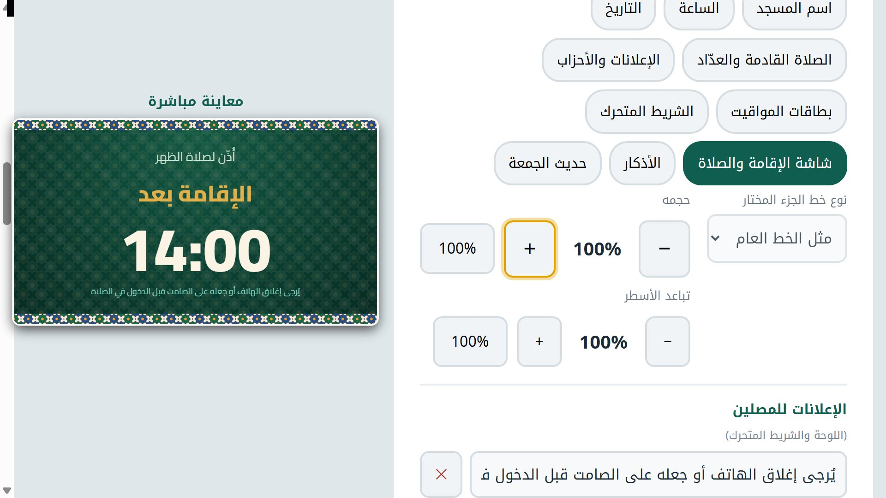

> إذا صار النص أكبر من إطاره يُصغَّر وحده ليبقى كاملاً، وتظهر ملاحظة: «نص هذا الجزء أكبر من إطاره…». حينها لن يكبر النص أكثر مهما زدت.

### 6.6 الإعلانات للمصلين
- كل إعلان في سطر. **+ إضافة إعلان** لإضافة سطر، و**✕** لحذفه.
- تظهر الإعلانات في اللوحة المتغيرة وفي الشريط المتحرك.
- **إعلانات صيام التطوع تلقائياً**: مفعّلة افتراضياً. وخيار **الإثنين والخميس** منفصل.

### 6.6.1 آداب المسجد والتنبيه بالكاميرات
- سبع نصائح في آداب المسجد، مع حديث صحيح لكل منها: حرمة المسجد، والكلام للضرورة فقط، وخفض الصوت، وتحية المسجد، وعدم المرور بين يدي المصلّي، وتجنّب الروائح الكريهة، ونظافة المسجد.
- تظهر **كلها في اللوحة** بالتناوب، و**واحدة في كل دورة للشريط المتحرك**، ثم التي بعدها.
- يمكن حذف أي نصيحة بـ ✕، أو إضافة نصيحة بـ **+ إضافة نصيحة** بهذا الشكل: `النصيحة | الحديث — المصدر`. والزر **استعادة النصائح الأصلية** يرجعها كما كانت.
- خانة **«المسجد مجهّز بكاميرات»** (غير مفعّلة افتراضياً) تعرض التنبيه: «حفاظاً على أمن المصلّين وممتلكاتهم، المسجد مجهّز بكاميرات للمراقبة».

### 6.7 حديث الجمعة
أسطر الحديث الذي يُعرض قبل أذان الجمعة، ويمكن تعديلها أو إضافة أسطر.

### 6.8 الأذكار بعد الصلاة
- اختر **أذكار صلاة**: كل الصلوات، أو صلاة بعينها (الصبح، الظهر، العصر، المغرب، العشاء، الجمعة).
- كل ذكر في سطر فيه ثلاث خانات: **العنوان**، و**النص** (السطور يفصل بينها /)، و**المصدر**.
- `(33)` في النص يظهر عدداً بلون مميز.
- `[آية الكرسي]` أو `[المعوذات]` في خانة النص تعرضها بالرسم العثماني، برواية ورش أو حفص.
- **استعادة الأذكار الأصلية** ترجع الأذكار المرفقة مع التطبيق.

### 6.9 الساعة والتاريخ
| مصدر الساعة | متى تختاره |
|---|---|
| **تلقائي: من الإنترنت** (الافتراضي) | الوقت الدقيق من الإنترنت مع التوقيت الرسمي للبلد، حتى لو كانت المنطقة الزمنية للجهاز خاطئة |
| **ساعة جهاز التلفاز** | إذا كانت ساعة الجهاز مضبوطة |
| **يدوي** | اكتب **التاريخ** (2026-11-21) و**الوقت** (18:45) ثم **ضبط الساعة**، أو استعمل ± ساعة و± دقيقة |

زر **إعدادات التاريخ والوقت في الجهاز** يفتح إعدادات النظام.

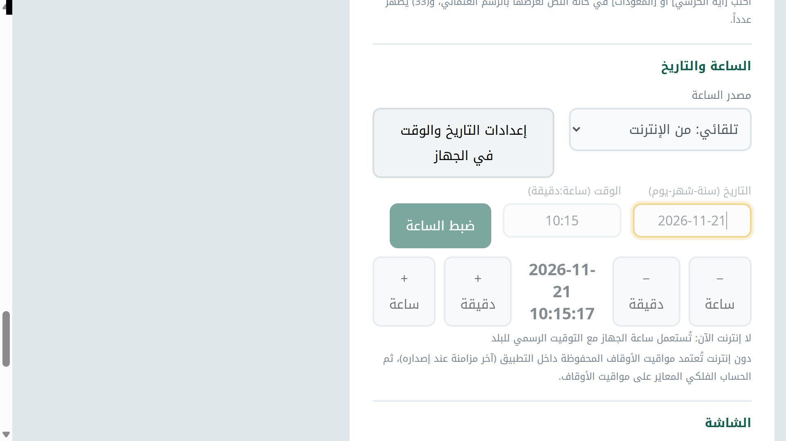

### 6.10 الشاشة
**دقة الشاشة**: تلقائي (أعلى دقة يدعمها الجهاز)، أو 4K، أو Full HD.

### 6.11 حول التطبيق
رقم النسخة، والمطوّر، وبريد الملاحظات، وآخر اتصال بالإنترنت، وزر **البحث عن نسخة جديدة الآن**.

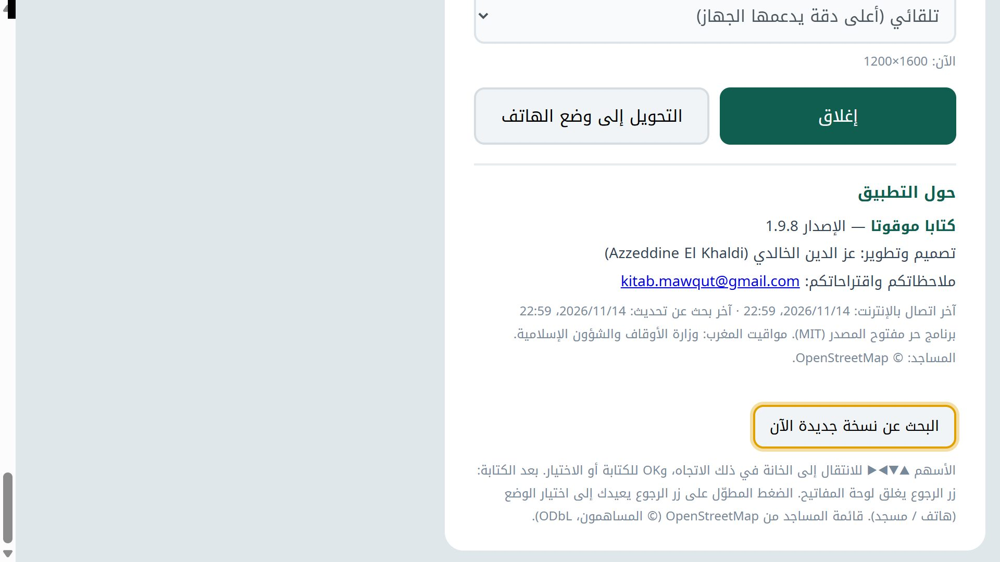

---

## 7. المساجد التي لا يصلها الإنترنت
- **المواقيت:** مواقيت وزارة الأوقاف لآخر الشهور المنشورة **محفوظة داخل التطبيق** عند إصداره. وكل شهر يُجلب أثناء الاتصال يُحفظ في الجهاز. بعد آخر شهر محفوظ يُستعمل حساب فلكي مضبوط على مواقيت الوزارة.
- **الساعة:** اختر «يدوي» في [الساعة والتاريخ](#69-الساعة-والتاريخ) واكتب التاريخ والوقت.
- **انقطاع الكهرباء:** كثير من أجهزة TV Box تفقد الوقت عند فصلها عن الكهرباء. حينها يظهر **شريط أحمر** في أعلى الشاشة: «يبدو أن الجهاز فقد التاريخ والوقت…». اضغط OK، فتنتقل مباشرة إلى خانة التاريخ.
- **يكفي أحياناً اتصال قصير** بنقطة اتصال الهاتف، فتُضبط الساعة وتُحدَّث المواقيت والتطبيق.

---

## 8. التحديث التلقائي
عند الاتصال بالإنترنت يبحث التطبيق عن نسخة جديدة بعد التشغيل، ثم كل 12 ساعة. إن وجدها يظهر شريط في أعلى الشاشة، والتحديد على زر **«تنزيل وتثبيت»**:

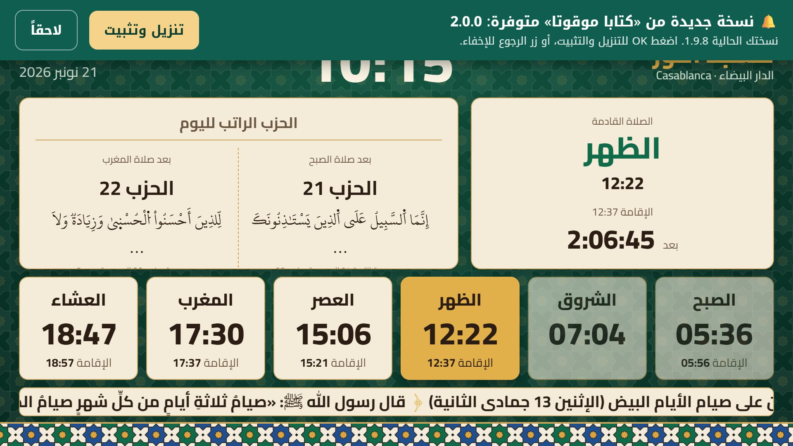

1. اضغط **OK**، فيُنزَّل التحديث داخل التطبيق ويظهر شريط التقدم.
2. **في أول تحديث فقط** يطلب أندرويد السماح للتطبيق بتثبيت التطبيقات: فعّل **«كتابا موقوتا» ← مسموح**، ثم اضغط الرجوع. إن أغلق النظام التطبيق فافتحه، فيكمل التثبيت وحده.
3. في شاشة أندرويد اختر **تثبيت**. إعداداتك تبقى محفوظة.

**أزرار الشريط:** ◀ ▶ بين «تنزيل وتثبيت» و«لاحقاً». ▲ من أعلى الإعدادات يرجعك إلى الشريط، و▼ يخرجك منه، والرجوع يخفيه. «لاحقاً» يؤجّل السؤال يوماً واحداً.

---

## 9. تطبيق الهاتف

| الورقة | التصاميم | الإعدادات | حول التطبيق |
|---|---|---|---|
| 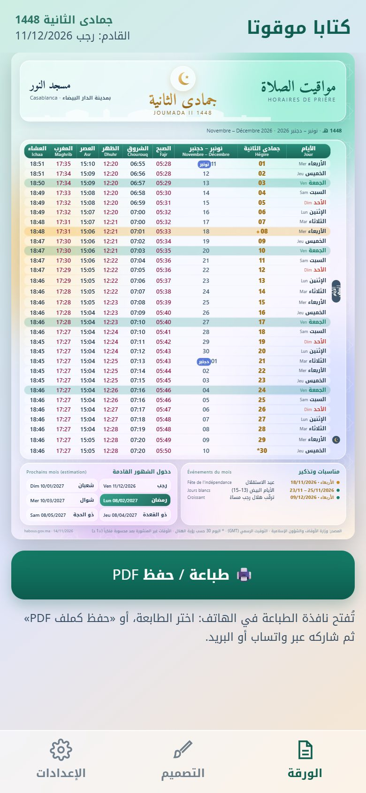 | 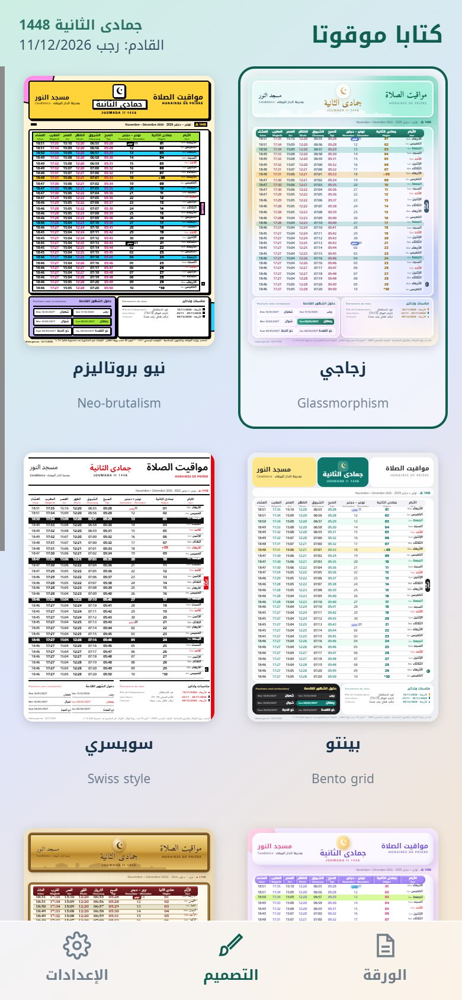 | 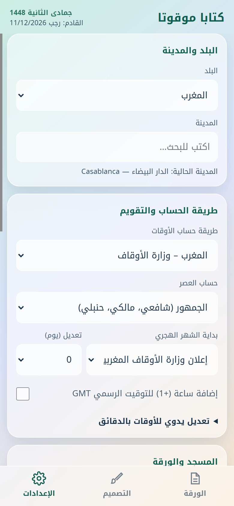 | 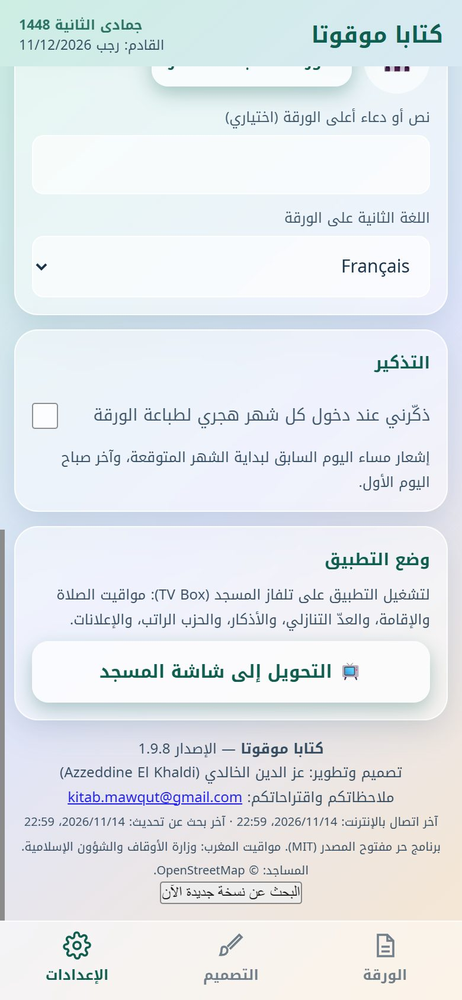 |

- **الورقة**: مواقيت الشهر الهجري الحالي، و**طباعة / حفظ PDF** من نافذة الطباعة في أندرويد (طابعة، أو PDF، أو مشاركة عبر واتساب والبريد).
- **التصميم**: ثمانية تصاميم: زجاجي، Neo-brutalism، بينتو، سويسري، صلصال، واقعي، Material، Y2K.
- **الإعدادات**: البلد والمدينة، وطريقة الحساب، وبداية الشهر الهجري، و+1 ساعة، واسم المسجد وصورته، ودعاء أعلى الورقة، واللغة الثانية، والتذكير عند دخول كل شهر، و**التحويل إلى شاشة المسجد**.
- يمكن التحكم في تطبيق الهاتف بالريموت أيضاً إن شغّلته على تلفاز.

---

## 10. أسئلة شائعة

**الساعة متقدمة أو متأخرة بساعة.** المنطقة الزمنية للجهاز خاطئة. اترك «مصدر الساعة» على **تلقائي: من الإنترنت**، أو اضبطها يدوياً.

**الصبح عندي غير صبح مسجدنا.** تحقق من **المدينة** وسطر المصدر تحتها. وإن كان مسجدكم يتبع توقيتاً خاصاً، فاستعمل **التعديل اليدوي بالدقائق**.

**الأيقونة القديمة ما زالت تظهر بعد التحديث.** أعد تشغيل التلفاز، فمشغّل التطبيقات يحتفظ بالأيقونات في ذاكرته.

**دخلت وضع الهاتف بالخطأ على التلفاز.** اضغط **مطوّلاً على زر الرجوع**، أو من الإعدادات: «التحويل إلى شاشة المسجد».

**التكبير لا يظهر.** النص يملأ إطاره، فيُصغَّر ليبقى كاملاً. صغّر تباعد الأسطر أو حجم أجزاء أخرى.

**الشاشة تنطفئ.** التطبيق يُبقي الشاشة مضاءة ما دام مفتوحاً. عطّل «توفير الطاقة» أو «Screen saver» في إعدادات التلفاز إن كانت تتدخل.

---

## 11. الملاحظات والاقتراحات
راسلونا على **kitab.mawqut@gmail.com**، أو افتحوا **Issue** في هذا المستودع.

تصميم وتطوير: عز الدين الخالدي (Azzeddine El Khaldi).
مصادر البيانات: مواقيت المغرب من وزارة الأوقاف والشؤون الإسلامية (habous.gov.ma)، والمساجد من © مساهمي OpenStreetMap (ODbL)، والمدن من GeoNames (CC BY 4.0)، ونص المصحف من مجمع الملك فهد ومن tanzil.net.

</div>
